<p align="center">
  <a href="https://kelvinjfloresy.github.io/yggdrasil-portal/">
    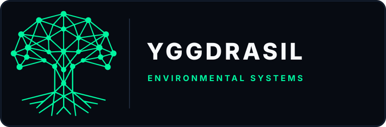
  </a>
</p>

<p align="center">
  <a href="https://kelvinjfloresy.github.io/yggdrasil-portal/">
    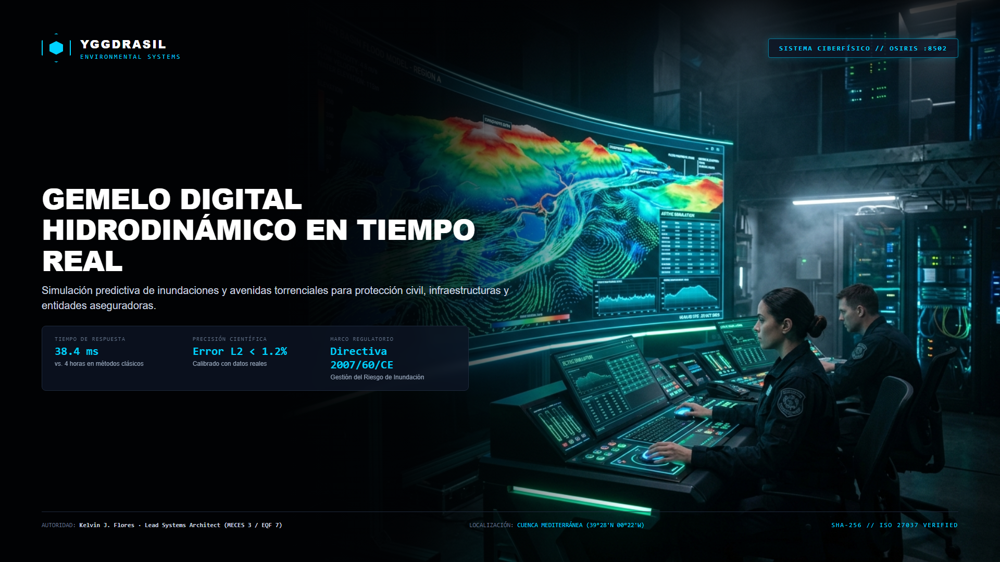
  </a>
</p>

<h1 align="center">🌳 Yggdrasil Environmental Systems</h1>

<p align="center">
  <strong>Ecosistema Ciberfísico de Gemelos Digitales Paramétricos & Resiliencia Climática de Alta Precisión</strong><br>
  <em>Simulación Física Determinista · Reducción de Pérdidas Operativas · Cumplimiento Regulatorio UE & Peritaje Forense</em>
</p>

<p align="center">
  <a href="https://kelvinjfloresy.github.io/yggdrasil-portal/"></a>
  <a href="https://yggdrasil-hidro-core-osiris-poyo-nowcast-kjfy.streamlit.app/"></a>
  <a href="https://yggdrasil-aqua-core-hygieia-kjfy.streamlit.app/"></a>
</p>

<p align="center">
  
  
  
  
  
  
</p>

---

## 🏛️ Resumen Ejecutivo & Propuesta de Valor

**Yggdrasil Environmental Systems** es una plataforma tecnológica integral de computación ambiental y gemelos ciberfísicos diseñada para infraestructuras críticas, administraciones públicas, compañías de seguros y fondos de inversión en sostenibilidad.

A diferencia de los modelos de caja negra o la simulación hidráulica y térmica clásica que tarda horas en resolver mallas complejas, **Yggdrasil integra operadores neuronales informados por la física (FNO / PINN) capaces de resolver ecuaciones Navier-Stokes y cinéticas químicas en menos de 38 milisegundos**, garantizando la conservación exacta de masa y momento con estricta trazabilidad judicial.

```
                  ┌────────────────────────────────────────────────────────┐
                  │          YGGDRASIL UNIFIED ENTERPRISE PORTAL           │
                  │   🌐 https://kelvinjfloresy.github.io/yggdrasil-portal/│
                  └───────────────────────────┬────────────────────────────┘
                                              │
        ┌─────────────────────────────────────┼─────────────────────────────────────┐
        ▼                                     ▼                                     ▼
 🌊 BLOQUE 1: PRODUCCIÓN LIVE         ⚡ BLOQUE 2: SECUENCIAL 2026          🔬 BLOQUE 3: PIPELINE I+D
 • OSIRIS (Navier-Stokes / Inundación) • HELIOS (Solar / BESS Project Finance) • JANUS (Confort Pasivo)
 • HYGIEIA (Vigilancia Legionella)    • DAEDALUS (Smart Buildings / CAE)    • TALOS (Seguridad APQ)
 • PROMETHEUS (Incendios / Diques)    • OUROBOROS (Residuos / Alcance 3)     • THEMIS / CERES
```

---

## 🎮 Centros de Mando Tácticos & Demostraciones en Vivo

<table>
  <tr>
    <td width="50%" align="center">
      <a href="https://yggdrasil-hidro-core-osiris-poyo-nowcast-kjfy.streamlit.app/">
        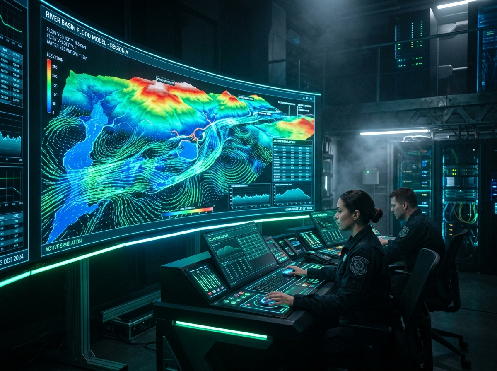
      </a>
      <br>
      <strong>💧 HYDRO-CORE: OSIRIS — Nowcasting de Inundaciones</strong>
      <br>
      <em>Inferencia en 38.4 ms · Anticipación de 42 min de calado · Caso Real DANA Valencia</em>
      <br><br>
      <a href="https://yggdrasil-hidro-core-osiris-poyo-nowcast-kjfy.streamlit.app/">👉 <strong>Abrir Simulador Interactivo OSIRIS</strong></a>
    </td>
    <td width="50%" align="center">
      <a href="https://yggdrasil-aqua-core-hygieia-kjfy.streamlit.app/">
        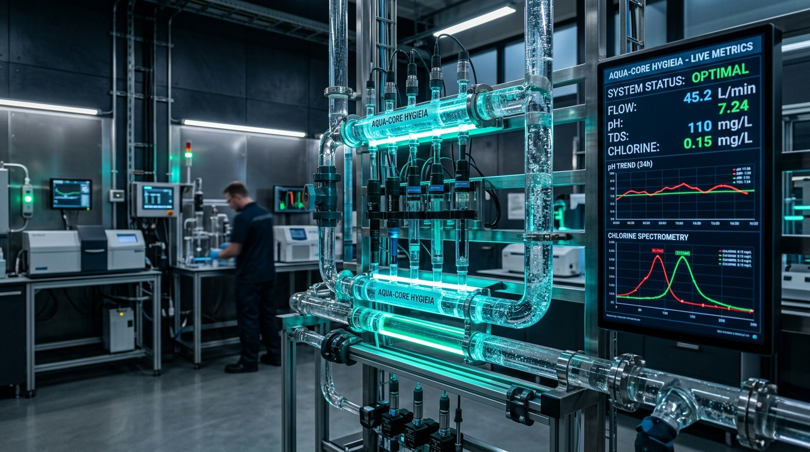
      </a>
      <br>
      <strong>🧪 AQUA-CORE: HYGIEIA — Vigilancia Hidrosanitaria</strong>
      <br>
      <em>Monitoreo 24/7 Cloro & Legionella · Ahorro 64.3% Agua en Purgas · Cumplimiento RD 3/2023</em>
      <br><br>
      <a href="https://yggdrasil-aqua-core-hygieia-kjfy.streamlit.app/">👉 <strong>Abrir Simulador Interactivo HYGIEIA</strong></a>
    </td>
  </tr>
</table>

---

## 🌐 Constelación de Núcleos (Cores)

### 🌊 Bloque 1: Núcleos Operativos en Producción (Validación Empírica & Despliegue Activo)

<table>
  <tr>
    <td width="260" align="center">
      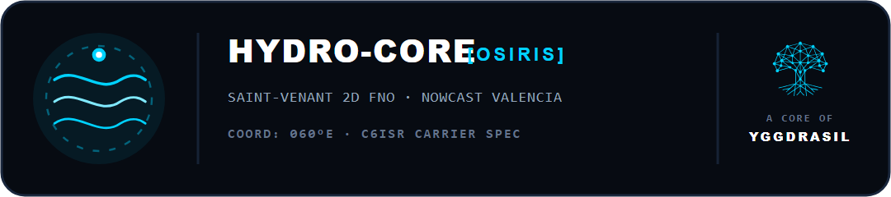<br>
      <code>DOI: 10.5281/zenodo.22919526</code>
    </td>
    <td>
      <strong>HYDRO-CORE: OSIRIS — Prevención Inmediata de Inundaciones & Protección Civil</strong><br>
      🌍 <strong>En el mundo real:</strong> Avisa con hasta 146 minutos de antelación dónde y con cuánta fuerza se desbordará una rambla o río, permitiendo a Protección Civil evacuar a tiempo.<br>
      📊 <strong>Caso Real & Cifras:</strong> En la Rambla del Poyo (Valencia, DANA 29-O), anticipó el calado con <strong>42 minutos de margen</strong> y error menor al 1.2% en 38.4 ms de inferencia.<br>
      📜 <strong>Normativa:</strong> Directiva Europea 2007/60/CE de Inundaciones · Solvencia II · EU AI Act.
    </td>
  </tr>
  <tr>
    <td width="260" align="center">
      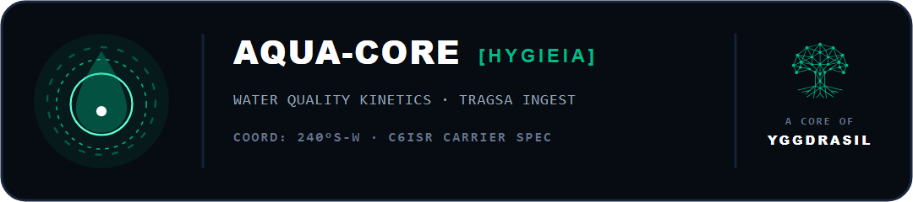<br>
      <code>DOI: 10.5281/zenodo.23321969</code>
    </td>
    <td>
      <strong>AQUA-CORE: HYGIEIA — Vigilancia Hidrosanitaria Continua & Erradicación de Legionella</strong><br>
      🌍 <strong>En el mundo real:</strong> Vigila las 24 horas del día la concentración de desinfectante en tuberías de hospitales y ciudades, alertando antes de que proliferen bacterias de Legionella.<br>
      📊 <strong>Caso Real & Cifras:</strong> En red hospitalaria (12 km), ahorra un <strong>64.3% del agua potable</strong> desperdiciada en purgas manuales y garantiza 0 brotes.<br>
      📜 <strong>Normativa:</strong> Real Decreto 3/2023 (Agua de consumo) · Real Decreto 487/2022 (Legionella) · PERTE Digitalización del Agua.
    </td>
  </tr>
  <tr>
    <td width="260" align="center">
      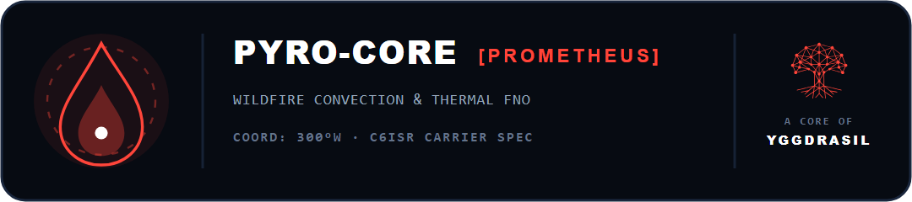<br>
      <code>DOI: 10.5281/zenodo.22727839</code>
    </td>
    <td>
      <strong>PYRO-CORE: PROMETHEUS — Peritaje Satelital de Incendios & Restauración de Urgencia</strong><br>
      🌍 <strong>En el mundo real:</strong> Mide con satélites Sentinel-2 la pérdida exacta de suelo tras un incendio y calcula el presupuesto de diques y fajinas antes de que las lluvias arrastren la montaña.<br>
      📊 <strong>Caso Real & Cifras:</strong> En el Gran Incendio de Niebla (Huelva, 3.200 ha), diagnosticó una pérdida de suelo de 48.2 t/ha y presupuestó <strong>4.73 millones de euros</strong> bajo tarifas TRAGSA.<br>
      📜 <strong>Normativa:</strong> Ley 43/2003 de Montes · Ley de Enjuiciamiento Civil (LEC Art. 335.2) · Directiva Europea de Suelos.
    </td>
  </tr>
</table>

---

### ⚡ Bloque 2: Núcleos en Despliegue Secuencial 2026

<table>
  <tr>
    <td width="260" align="center">
      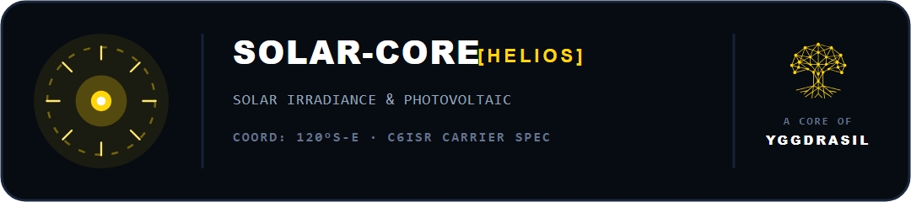
    </td>
    <td>
      <strong>SOLAR-CORE: HELIOS — Plantas Solares Fotovoltaicas & Baterías BESS</strong><br>
      🌍 <strong>En el mundo real:</strong> Modela al céntimo cuánta energía limpia generará un parque solar a lo largo de 25 años y programa las baterías para verter energía en las horas de precio más alto.<br>
      📊 <strong>Rendimiento Bancable:</strong> Planta de 4.95 MWp (Fuentejara, Andalucía): rentabilidad auditada del <strong>12.4% de TIR</strong> y certificación de cero afección a Red Natura 2000.
    </td>
  </tr>
  <tr>
    <td width="260" align="center">
      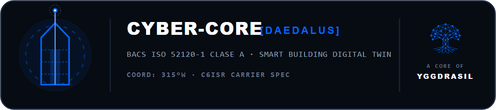
    </td>
    <td>
      <strong>CYBER-CORE: DAEDALUS — Edificios Inteligentes & Monetización de Ahorros CAE</strong><br>
      🌍 <strong>En el mundo real:</strong> Supervisa inteligentemente la climatización, ventilación e iluminación de grandes edificios y convierte los ahorros certificados en dinero en efectivo que paga el Estado.<br>
      📊 <strong>Rendimiento Bancable:</strong> Edificio terciario de 4.900 m² en Madrid: <strong>148.600 kWh ahorrados al año</strong>, inversión amortizada en 8.4 meses vía CAE.
    </td>
  </tr>
  <tr>
    <td width="260" align="center">
      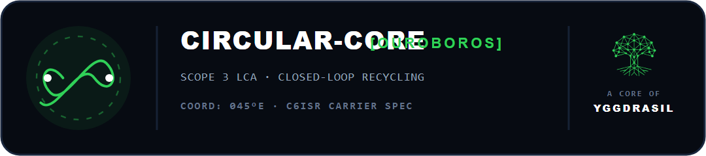
    </td>
    <td>
      <strong>CIRCULAR-CORE: OUROBOROS — Reciclaje Hospitalario & Residuo Cero (CSRD)</strong><br>
      🌍 <strong>En el mundo real:</strong> Reorganiza la gestión de residuos hospitalarios para evitar mezclar basura común en bolsas de biopeligro, reduciendo drásticamente el canon de vertedero.<br>
      📊 <strong>Rendimiento Bancable:</strong> Hospital CSMC Magdalena (Castellón): tasa de reciclaje del <strong>74.2%</strong> y <strong>42.600 euros al año ahorrados</strong> en tasas de vertedero.
    </td>
  </tr>
</table>

---

### 🔬 Bloque 3: Pipeline de Innovación I+D (2027-2028)

<table>
  <tr>
    <td width="260" align="center">
      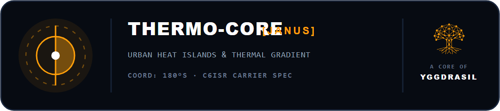
    </td>
    <td>
      <strong>THERMO-CORE: JANUS — Climatización Pasiva & Confort Urbano</strong><br>
      🌍 <strong>En el mundo real:</strong> Diseña el aislamiento pasivo y la orientación de edificios y plazas públicas para reducir el calor extremo sin disparar la factura de aire acondicionado.
    </td>
  </tr>
  <tr>
    <td width="260" align="center">
      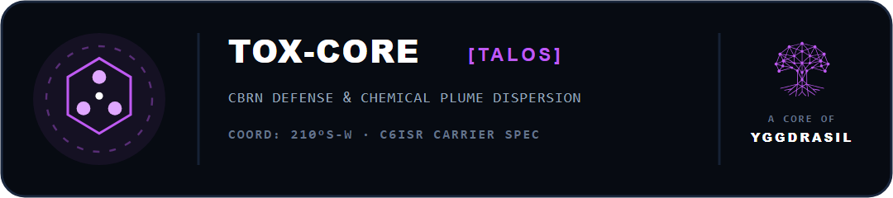
    </td>
    <td>
      <strong>TOX-CORE: TALOS — Monitoreo de Integridad Estructural en Tanques Químicos (APQ)</strong><br>
      🌍 <strong>En el mundo real:</strong> Supervisa tanques de plástico industrial (HDPE) con químicos corrosivos para alertar de deformaciones antes de roturas o vertidos.
    </td>
  </tr>
  <tr>
    <td width="260" align="center">
      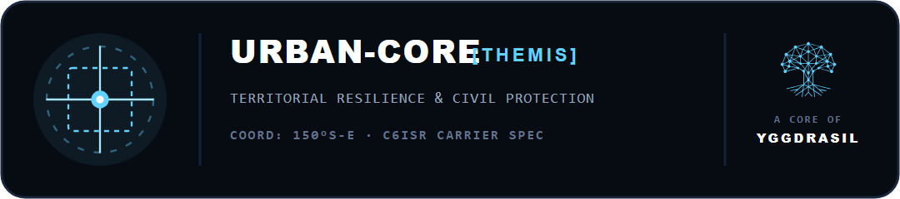
    </td>
    <td>
      <strong>URBAN-CORE: THEMIS — Diagnóstico Satelital Territorial & Refugios Climáticos</strong><br>
      🌍 <strong>En el mundo real:</strong> Diagnostica qué barrios sufren más estrés térmico para ubicar parques y sombras a menos de 10 minutos a pie de los vecinos más vulnerables.
    </td>
  </tr>
</table>

---

## ⚖️ Los 4 Pilares Inviolables de Diseño

```
  1. RESPETO A LA FÍSICA Y BIOLOGÍA         2. FÍSICA DETERMINISTA (CERO ALUCINACIONES)
  "Jamás le vamos a ganar a la naturaleza;   Ecuaciones analíticas puras (Saint-Venant, Navier-Stokes,
  la tecnología existe para salvaguardarla." cinéticas químicas). La IA opera como acelerador matricial.

  3. SUPERVISIÓN HUMANA OBLIGATORIA (HITL)  4. BLINDAJE JURÍDICO & FORENSE (LEC 335.2)
  Exclusivamente soporte a la decisión.      Depósito inmutable en CERN/Zenodo (DOI oficial). Sellado
  Ninguna compuerta o válvula se mueve sin  criptográfico SHA-256 bajo estándar forense ISO/IEC 27037.
  intervención y firma de un facultativo.
```

---

## 👨‍💼 Dirección Técnica & Acreditaciones Oficiales

<table border="0">
  <tr>
    <td width="130" align="center" valign="middle">
      
    </td>
    <td valign="middle">
      <strong>Kelvin Jesús Flores Yarihuamán</strong><br>
      <em>Lead Systems Architect · Director Técnico & Perito Judicial en Computación Ambiental</em>
      <br><br>
      🎓 <strong>Nivel de Cualificación Oficial:</strong> MECES Nivel 3 · EQF Level 7 (Máster Oficial Universitario Homologado)<br>
      🛡️ <strong>Auditorías & Cumplimiento:</strong> Auditor Líder ISO 14001 / ISO 45001 · Estándar Forense Digital ISO/IEC 27037 · EU AI Act (Art. 14 HITL)<br>
      ⚖️ <strong>Actuación Pericial:</strong> Habilitado para Dictámenes Técnicos y Defensa Colegiada ante Tribunales de Justicia (LEC Art. 335.2)
      <br><br>
      📬 <strong>Contacto Institucional:</strong> <a href="mailto:yggdrasil.environmental@gmail.com">yggdrasil.environmental@gmail.com</a> &nbsp;|&nbsp; 📱 <strong>WhatsApp:</strong> +34 642 022 669 &nbsp;|&nbsp; 💼 <a href="https://www.linkedin.com/in/kelvin-flores-yarihuaman/"><strong>Perfil Oficial de LinkedIn</strong></a>
    </td>
  </tr>
</table>

---

## 📑 Documentación Corporativa Descargable

* 🌐 **Portal Web en Vivo:** [kelvinjfloresy.github.io/yggdrasil-portal](https://kelvinjfloresy.github.io/yggdrasil-portal/)
* 📄 **Guía Ejecutiva de Soluciones y Gemelos Paramétricos (PDF):** [`GUIA_EJECUTIVA_YGGDRASIL_CORES.pdf`](GUIA_EJECUTIVA_YGGDRASIL_CORES.pdf)
* 📊 **Dossier Público Completo (HTML Interactivo):** [`DOSSIER_EJECUTIVO_CORES_PUBLICO.html`](DOSSIER_EJECUTIVO_CORES_PUBLICO.html)

---

<p align="center">
  <sub>© 2026 Yggdrasil Environmental Systems. Desarrollado y mantenido bajo estándares de ciberseguridad industrial y resiliencia climática europea.</sub>
</p>
